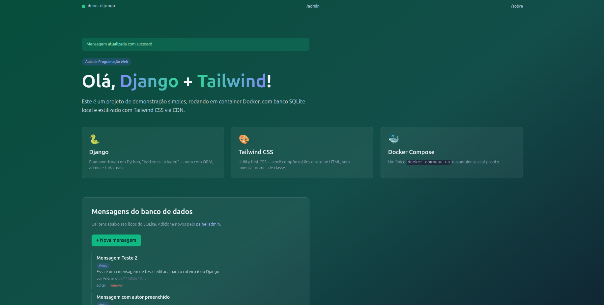
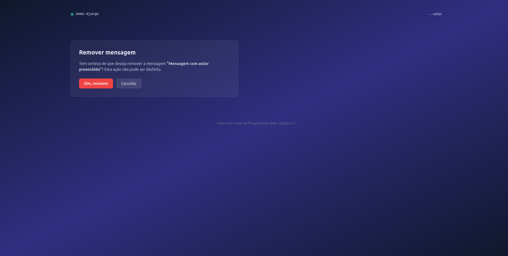
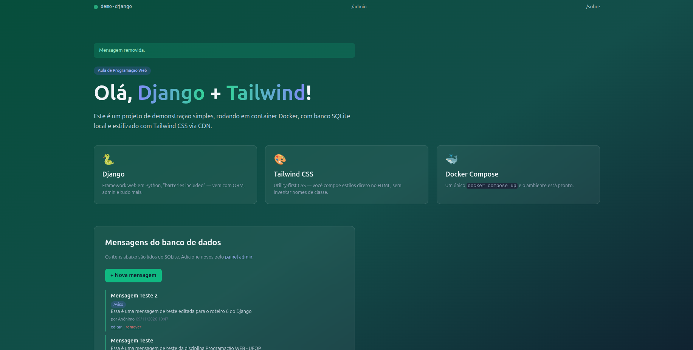

# Sistema Django 

## Informações

- **Nome:** Matheus Rodrigues Pereira de Souza - 24.1.4010
- **Curso:** Ciência da Computação
- **Disciplina:** Programação Web - BCC-481

## Sistema em execução

**Página Inicial**

**Página Editar Mensagem**

**Página Inicial com confirmação de mensagem editada**

**Página Remover Mensagem**

**Página Inicial com confirmação de mensagem removida**

